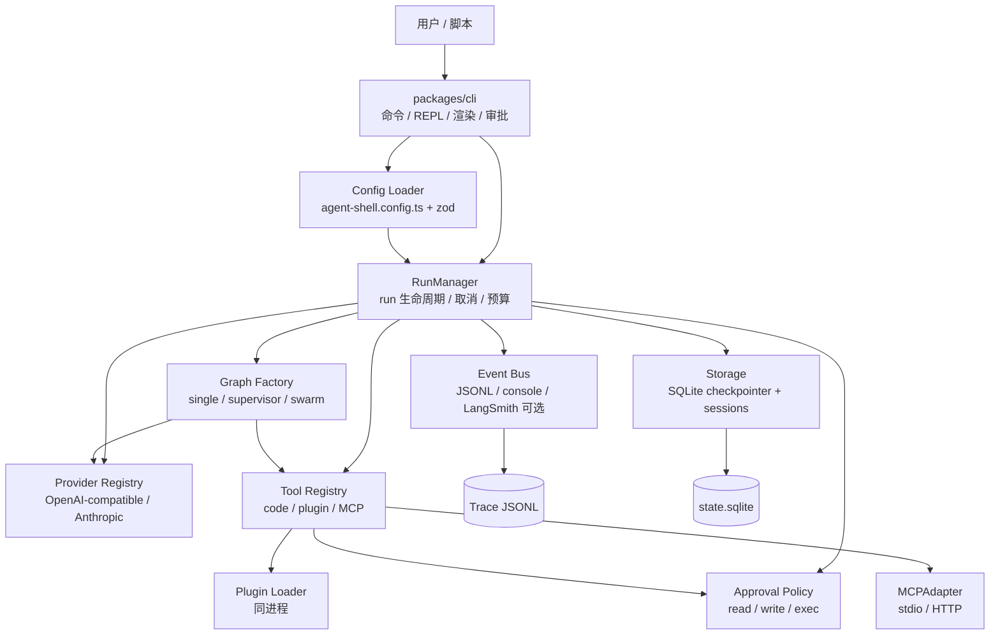
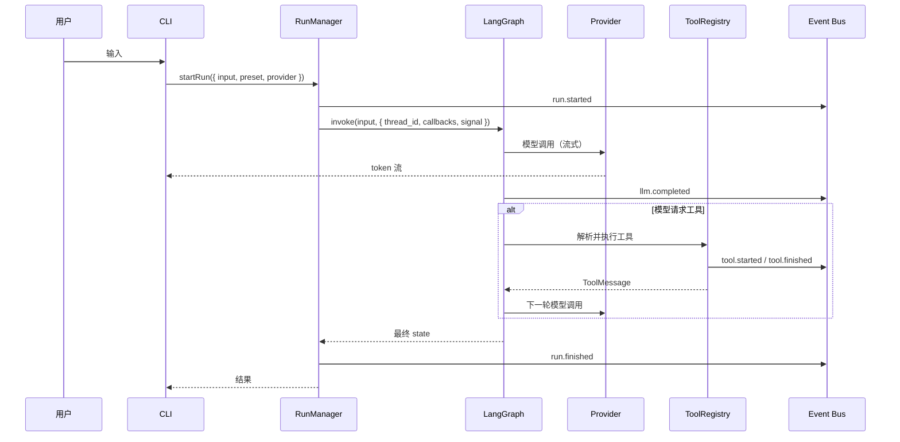
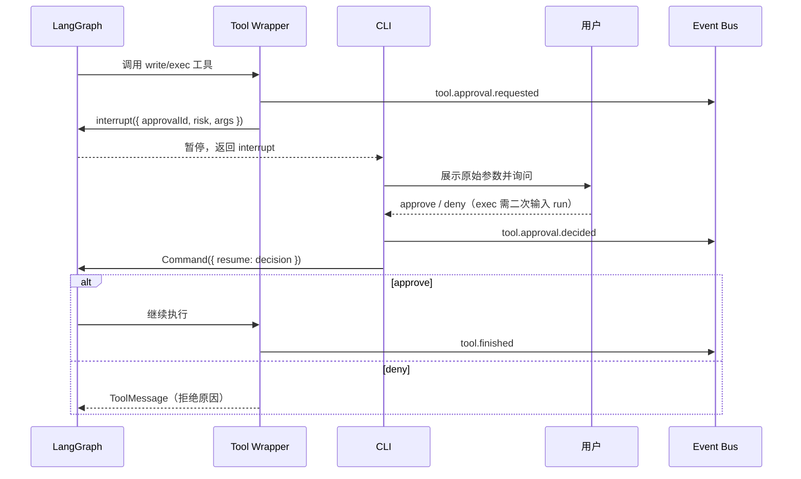

# 01 · 架构设计

> 状态：设计基线，阶段 0 冻结契约  
> 日期：2026-11-03  
> 关联：[00-requirements.md](./00-requirements.md)、[02-roadmap.md](./02-roadmap.md)、[03-cli-and-trace.md](./03-cli-and-trace.md)、[ADR-0001..0008](./decisions/)

## 1. 设计原则

1. **核心零业务**：`@agent-shell/core` 只提供运行时原语；业务工具与 agent 定义只存在于配置和 `examples/`。
2. **依赖单向**：`cli → core → LangChain/LangGraph`；core 不得 import cli 或 examples；插件只能 import `@agent-shell/core/plugin`。
3. **一切可观测**：模型、工具、审批、子 agent、插件、MCP 都必须发事件；事件 schema 版本化。
4. **默认安全**：风险声明必填；write/exec 必经审批；非交互默认拒绝；失败关闭。
5. **契约先行**：config、event、tool、plugin 四套 schema 在阶段 0 冻结。
6. **框架适配层**：LangGraph、LangChain、supervisor/swarm、MCP 都包一层 adapter，避免上游 API 变更扩散到全仓。
7. **不过度抽象**：三种子 agent 形态直接复用官方实现；不自造通用编排 DSL。

## 2. 总体架构



**关键点**：

- CLI 不直接构造模型或工具，只调用 core 的公开 API。
- `agent-shell.config.ts` 是**组合根**：导入代码工具、定义 agent 与 preset；core 不反向依赖它。
- 事件总线是旁路，不阻塞主循环；trace 是真相源，console 与 LangSmith 只是投影。

## 3. 计划目录结构

```text
agent-shell/
  AGENT.md
  README.md
  docs/
    00-requirements.md
    01-architecture.md
    02-roadmap.md
    03-cli-and-trace.md
    04-testing-and-acceptance.md
    decisions/
      ADR-0001-langgraph-runtime.md
      ...
    phases/
      00-contracts.md          # 阶段开始时按模板创建
  packages/
    core/
      src/
        runtime/               # RunManager、预算、取消、错误映射
        graph/                 # single / supervisor / swarm 工厂
        providers/             # ProviderRegistry、能力矩阵、usage
        tools/                 # ToolRegistry、风险、审批包装、路径守卫
        agents/                # spawn、supervisor、swarm 适配
        events/                # schema、emitter、sink、脱敏
        storage/               # checkpointer、session 元数据
        config/                # schema、loader、env
        errors/                # 错误类型
        testing/               # ScriptedChatModel、fixtures（子路径导出）
      package.json
    cli/
      src/
        commands/              # chat / run / trace / tools / ...
        repl/                  # 交互循环、命令解析
        render/                # 流式渲染、事件树
        approvals/             # 审批交互
      bin/agent-shell.js
      package.json
  examples/
    file-agent/
      agent-shell.config.ts
      tools/
      agents/
      plugins/word-count/
      mcp-echo-server/
      scenario.acceptance.json
      model.script.json
```

> 目录是计划，不是当前仓库状态。阶段 0 按此骨架落地。

## 4. 运行时主流程

### 4.1 一次普通对话



### 4.2 审批与恢复



### 4.3 子 agent

- `spawn`：父 agent 调用 `runtime__spawn_subagent` 工具；RunManager 创建子 run、子 span、独立 messages 和受限工具集；只把最终答案回传父 agent。
- `supervisor`：官方 `createSupervisor` 组合多个 `createReactAgent` worker；supervisor 通过 handoff 工具分派。
- `swarm`：官方 `createSwarm` + `createHandoffTool`；共享 messages，`activeAgent` 记录当前控制者；必须带 checkpointer。
- 三者都受 `limits` 约束，事件都带 `parentSpanId`。

## 5. 组件设计

### 5.1 Runtime / RunManager

**职责**：

- 生成 `runId`、`sessionId`、`spanId`，维护 run 树；
- 解析 preset，构建或复用编译好的 graph；
- 管理 `AbortController`、预算计数器、事件 sink 生命周期；
- 处理 interrupt：把审批请求交给 CLI，收到 decision 后用 `Command` 恢复；
- 映射错误到退出码，保证 trace 落盘后再返回。

**边界**：

- 不解析业务参数；
- 不直接构造 LangChain 模型或工具；
- 不渲染输出。

**运行状态**：每个 run 独立；同一 session 串行执行（CLI 层保证），不同 session 可并行（库层允许）。

**预算**：`maxSteps`、`tokenBudget`、`maxWallTimeMs`、`maxSubagents`、`maxSubagentDepth`。每次模型调用和工具调用前检查；超限时发 `budget.exceeded`，停止当前 run，保留已完成的部分状态。

| 限制 | 默认值 | 说明 |
| --- | --- | --- |
| `maxSteps` | 40 | 主 agent 模型调用次数 |
| `tokenBudget` | 200,000 | 单 run 总 token（含子 agent） |
| `maxWallTimeMs` | 900,000 | 单 run 墙钟 15 分钟 |
| `maxSubagents` | 8 | 单 run 派生子 agent 总数 |
| `maxSubagentDepth` | 2 | 子 agent 最大嵌套深度 |

### 5.2 Graph Factory

| Graph | 实现 | 用途 |
| --- | --- | --- |
| `single` | 自建 LangGraph `StateGraph`：`model` 节点 + `tools` 节点 + 条件边 | 主 agent；精确控制事件、预算、审批 |
| `supervisor` | 包装 `@langchain/langgraph-supervisor` 的 `createSupervisor` | 主管-工人层级 |
| `swarm` | 包装 `@langchain/langgraph-swarm` 的 `createSwarm` + `createHandoffTool` | 去中心化 handoff |

**为什么主循环自建**：官方 `createReactAgent` 足够好，但主循环需要精确控制预算检查、审批包装、事件写入和取消；自建 StateGraph 仍属于 LangGraph，不违背 ADR-0001。子 agent 叶子节点使用 `createReactAgent`，因为 supervisor/swarm 包依赖该形态。

**状态**：

- `messages`：LangChain `BaseMessage[]`；
- `stepCount`：模型调用次数；
- `budget`：已用 token / 子 agent 数；
- 元数据：`sessionId`、`runId`、`provider`、`model`、`preset`。

**终止条件**：无工具调用、达到 `maxSteps`、预算耗尽、用户取消、未恢复的错误。

**递归上限**：同时使用业务 `maxSteps` 与 LangGraph `recursionLimit`；两者的映射在阶段 1 用测试固定，避免只依赖框架计数。

### 5.3 Provider Registry

| 能力 | 设计 |
| --- | --- |
| 接入方式 | `@langchain/openai` 的 `ChatOpenAI`、`@langchain/anthropic` 的 `ChatAnthropic` |
| 选择语法 | `provider:model`，例如 `openai:gpt-4.1-mini`、`anthropic:claude-sonnet-4-6` |
| 配置 | `kind`、`apiKey`、`baseURL`、`headers`、`models`、`timeoutMs`、`maxRetries` |
| 能力矩阵 | `streaming`、`toolCalling`、`vision`、`contextWindow`；阶段 0 冻结默认值 |
| usage | 优先取 provider 返回的 usage；缺失时按字符估算并标记 `estimated: true` |
| 超时/重试 | 默认 120s / 2 次；指数退避；流式中断不自动重试，除非尚未产生 token |
| 切换 | provider 按 run 生效；同一 thread 跨 provider 仅 best-effort，失败时提示 `/new` |

**不做自研 wire protocol**：LangChain 已经有统一的 `BaseChatModel`；壳的价值在配置、能力校验、事件和预算，不在重复实现 HTTP。

### 5.4 Tool Registry

**三种来源**：

| 来源 | 注册方式 | 信任级别 | 默认风险 | 命名 |
| --- | --- | --- | --- | --- |
| code | `agent-shell.config.ts` 中 `defineTool` | 可信本地代码 | 必须显式声明 | 声明名（安全字符） |
| plugin | `plugins/` 目录 + manifest，同进程 import | 可信本地代码 | 必须显式声明 | `plugin__<plugin>__<tool>` |
| MCP | `MCPAdapter` 连接 server，`listTools()` | 外部不可信 | `exec`（有只读注解才降级） | `mcp__<server>__<tool>` |

**注册校验**：

- 名称必须匹配 `^[a-z][a-z0-9_]{0,63}$`；最终名称冲突时启动失败；
- `schema` 必须是 zod schema；
- code/plugin 工具缺 `risk` 直接拒绝注册；
- `timeoutMs` 默认 30s；
- `idempotent` 默认 false；只影响重试策略。

**执行流水线**：

1. 解析工具名，取回定义；
2. zod 校验参数；
3. 走审批策略（read 跳过，write/exec 中断）；
4. 在超时与 AbortSignal 下执行；
5. 归一化结果：文本 / 结构化 / 错误；
6. 发 `tool.started`、`tool.finished` / `tool.error`；
7. 返回 `ToolMessage`，错误也作为消息回给模型，让模型有机会纠正。

**v1 执行策略**：同一轮模型返回多个 tool call 时，**顺序执行**，审批提示串行；这是为了确定性 trace 和审批 UX。并发优化留到后续版本。

**结果上限**：进入 trace 的单个工具结果默认截断到 16KB；超限记录 `truncated: true` 和内容哈希。

### 5.5 Approval Policy

| 风险 | 默认行为 | 说明 |
| --- | --- | --- |
| `read` | 自动放行 | 只读、无副作用；仍记录 `tool.started` |
| `write` | 一次确认 | 展示工具名、来源、原始参数、目标路径 |
| `exec` | 两次确认 | 第一次确认意图；第二次要求输入 `run` |

**策略配置**：

- `approvals.allowlist`：按工具名 + 参数模式自动批准；
- `--yolo`：跳过所有审批，但硬拒绝列表仍生效；
- `--allow-outside-workspace`：允许文件工具越过 workspaceRoot；
- 非交互（无 TTY 且无脚本策略）：write/exec 默认拒绝（fail-safe）；
- 审批超时：`approvals.timeoutMs`，0 表示无限等待；超时视为拒绝。

**实现**：在工具 handler 内调用 LangGraph `interrupt()`；CLI 收到后提示，用户决定后用 `Command({ resume })` 恢复。exec 的第二次确认是第二次 `interrupt()`。所有决定写 `tool.approval.decided`。

**硬拒绝**：明显的破坏性命令（`rm -rf /`、`sudo`、`mkfs`、`dd of=/dev/*` 等）即使 `--yolo` 也拒绝；这是安全网，不是沙箱。

**并行调用**：审批提示全局串行；顺序与模型返回的 tool call 顺序一致。

### 5.6 Subagent Runtime

| 形态 | 实现 | 上下文 | 适用 |
| --- | --- | --- | --- |
| `spawn` | 自建原语：编译子 `createReactAgent`，独立 messages，受限工具集 | 只传 task + 显式 context；只回传最终答案 | 一次性子任务、上下文隔离 |
| `supervisor` | 官方 `createSupervisor` | supervisor 控制消息历史；`outputMode` 可选 | 主管分派多个专家 |
| `swarm` | 官方 `createSwarm` + `createHandoffTool` | 共享 messages + `activeAgent` | 专家之间动态移交 |

**spawn 细节**：

- 工具名 `runtime__spawn_subagent`；
- 参数：`task`、`agent`（引用配置里的 agent 定义）、可选 `context`；
- 子 agent 的工具集必须是父 agent 工具集的子集，否则拒绝；
- 独立 `runId`/`spanId`，`parentSpanId` 指向父工具调用；
- 默认 depth ≤ 2、每次 run 最多 8 个子 agent、子 agent `maxSteps` 默认 20；
- 父 run 取消时，子 run 通过 AbortSignal 级联取消；
- 子 agent 失败以 `ToolMessage` 错误返回父 agent，不使整个 run 崩溃。

**supervisor / swarm 包装**：

- 在 core 的 `agents/` 中包装官方包，不让 CLI 直接依赖；
- 编译时必须传 checkpointer；
- 识别 handoff 工具调用并补发 `subagent.handoff` 事件；
- 版本锁定；若上游 API 变更，优先在 adapter 内兼容，必要时内联复刻。

**预算继承**：子 agent 继承父 run 的剩余预算；子 agent 的消耗计入父 run 的总 token/子 agent 数。

### 5.7 Sessions 与存储

| 数据 | 位置 | 说明 |
| --- | --- | --- |
| LangGraph checkpoint | `.agent-shell/state.sqlite` | thread_id = sessionId；由 checkpointer 管理表结构 |
| session 元数据 | 同一 SQLite 的 `sessions` 表 | id、title、created_at、updated_at、last_provider、last_model |
| trace | `.agent-shell/traces/<sessionId>/<runId>.jsonl` | 每 run 一个文件；事件流真相源 |
| 配置 | `agent-shell.config.ts` | 组合根，不含秘密 |

- SQLite 使用 WAL；单进程单用户；不做并发写优化。
- `trace list` 扫描 trace 目录；`trace show` 读取 JSONL；`trace tail` 跟随写入。
- 会话恢复依赖 checkpointer；provider 切换按 run 生效，跨 provider 同 thread 仅 best-effort。

### 5.8 Events / Trace

- **Emitter**：通过 LangGraph custom stream writer（`config.writer`）+ LangChain callback handler 双通道采集；统一成 `AgentEvent`。
- **异步写入**：事件先入内存队列，批量写 JSONL；流式输出不等待磁盘。
- **关联**：`sessionId`、`runId`、`spanId`、`parentSpanId` 贯穿所有事件；LangChain `runId` 映射到 `spanId`。
- **脱敏与截断**：见 [03-cli-and-trace.md](./03-cli-and-trace.md)；默认不落 token delta。
- **LangSmith**：可选导出，通过环境变量开启；不参与验收，不作为依赖。

事件 schema v1 的完整定义在 [03-cli-and-trace.md](./03-cli-and-trace.md)。

### 5.9 Config

- **组合根**：`agent-shell.config.ts` 导入代码工具、定义 agent 与 preset；CLI 用 jiti 加载，zod 校验。
- **密钥**：只从环境变量读取；`env()` 助手在缺失时抛出可操作错误；启动时只校验已启用 provider 的必需变量。
- **优先级**：CLI 参数 > 环境变量 > 配置文件 > 默认值。
- **发现顺序**：`--config` > 当前目录 `agent-shell.config.ts` > `~/.agent-shell/config.ts`。
- **信任**：配置文件是可执行本地代码，与插件同级信任；不加载远程配置。
- **`doctor`**：检查配置、密钥存在性、provider 参数、插件 manifest、MCP server 可达性；默认不做计费请求，`--probe` 才发最小请求。

### 5.10 CLI

- 只做命令解析、交互、渲染和审批；不包含运行时逻辑。
- 命令面、REPL 命令、输出模式、退出码见 [03-cli-and-trace.md](./03-cli-and-trace.md)。
- 无 TUI 框架；ANSI + readline 足够。后续如需 TUI/Web，另起阶段与 ADR。

## 6. 关键契约（草图）

> 以下是阶段 0 要冻结的接口形状，不是实现代码。最终字段以阶段 0 的 schema 文档为准。

### 6.1 配置

```ts
type AgentShellConfig = {
  providers: Record<string, ProviderConfig>;
  defaults: { provider: string; preset?: string };
  workspaceRoot?: string;
  tools?: { code?: ToolDefinition[] };
  plugins?: { enabled?: boolean; dirs?: string[] };
  mcp?: { servers?: Record<string, McpServerConfig>; configFile?: string };
  agents?: Record<string, AgentDefinition>;
  presets?: Record<string, PresetDefinition>;
  approvals?: ApprovalConfig;
  limits?: Limits;
  trace?: TraceConfig;
};

type PresetDefinition =
  | { kind: "single"; agent: string }
  | { kind: "supervisor"; supervisor: string; agents: string[]; outputMode?: "full_history" | "last_message" }
  | { kind: "swarm"; agents: string[]; defaultActiveAgent: string };

type AgentDefinition = {
  name: string;
  prompt: string;
  tools: string[];
  provider?: string;
  model?: string;
  limits?: Partial<Limits>;
};
```

### 6.2 工具

```ts
type ToolDefinition = {
  name: string;
  description: string;
  schema: unknown;              // zod schema，阶段 0 收紧类型
  risk: "read" | "write" | "exec";
  timeoutMs?: number;
  idempotent?: boolean;
  execute: (args: unknown, ctx: ToolContext) => Promise<ToolResult>;
};
```

### 6.3 审批与预算

```ts
type ApprovalRequest = {
  approvalId: string;
  tool: string;
  source: "code" | "plugin" | "mcp";
  risk: "read" | "write" | "exec";
  argsPreview: unknown;
  attempt: 1 | 2;
};

type ApprovalDecision =
  | { decision: "approve"; confirmation?: "run" }
  | { decision: "deny"; reason?: string };

type Limits = {
  maxSteps: number;
  tokenBudget: number;
  maxWallTimeMs: number;
  maxSubagents: number;
  maxSubagentDepth: number;
};
```

### 6.4 事件

事件信封与类型见 [03-cli-and-trace.md](./03-cli-and-trace.md)。核心约束：

- `v` 固定为 1；
- 所有事件必须有 `sessionId`、`runId`、`spanId`；
- 子 span 必须有 `parentSpanId`；
- payload 不得包含秘密；预览字段统一截断。

## 7. 安全模型

| 信任边界 | 例子 | 控制 |
| --- | --- | --- |
| 用户输入 | 聊天内容、文件内容 | 视为不可信；模型输出不可直接执行；write/exec 审批 |
| 模型输出 | tool calls、handoff | 不可信；参数必须 zod 校验；审批展示原始参数 |
| 配置文件 | `agent-shell.config.ts` | 本地可信代码；启动时校验；不加载远程配置 |
| 代码工具 | config 中注册 | 本地可信代码；必须声明风险；仍走审批 |
| 插件 | `plugins/` 目录 | 本地可信但同进程全权限；显式启用；文档明确风险；v1 不沙箱 |
| MCP server | 外部进程/远程 | 外部不可信；默认 `exec`；超时；输出当数据不当指令；不自动批准 |
| Trace | 本地 JSONL | 默认脱敏；不记录 headers/api key；截断大结果 |
| 供应链 | npm 依赖 | 锁定版本 + lockfile；阶段 0 关闭 postinstall；升级走 ADR/验收 |

**提示注入**：审批 UI 必须展示工具名、来源和原始参数；不得用模型生成的摘要替代。MCP 工具输出可能包含诱导性文本，模型可能被操纵，审批是最后一道防线。

**秘密**：

- 只从环境变量读取；
- `env()` 只在已启用 provider/工具需要时读取；
- trace 脱敏规则见 03；
- 错误消息不得包含 headers、apiKey、完整 baseURL 凭证；
- `.env`、`.agent-shell/`、SQLite、trace 文件加入 `.gitignore`。

**工作区边界**：

- `workspaceRoot` 默认是配置文件所在目录；
- 文件类工具解析路径时执行：normalize → 拒绝 `..` 越界 → 解析 realpath → 拒绝 symlink 逃逸；
- 新文件校验父目录 realpath；
- 越界默认拒绝，只有 `--allow-outside-workspace` 或 allowlist 规则放行；
- 插件和 MCP 工具不自动受此边界约束，其风险由声明/默认 `exec` 覆盖。

## 8. 失败、重试、取消

### 8.1 错误分类

| 错误 | 触发 | 退出码 |
| --- | --- | --- |
| `UnexpectedError` | 未预期的内部错误 | 1 |
| `ConfigError` | 配置非法、密钥缺失、命名冲突 | 2 |
| `ProviderError` | 鉴权、限流、网络、协议错误 | 3 |
| `ToolError` | 工具执行失败、参数校验失败 | 4 |
| `ApprovalDenied` | 用户拒绝且无法继续 | 5 |
| `BudgetExceeded` | 步数/token/时间/子 agent 超限 | 6 |
| `CancelledError` | 用户取消 | 130 |
| `PluginError` | manifest/加载/执行错误 | 4（工具错误）或 2（启动错误） |
| `McpError` | 连接/调用/超时 | 4 |
| `SubagentError` | 子 agent 失败且父级无法恢复 | 4 |

### 8.2 重试

- Provider：默认 `maxRetries = 2`，指数退避；流式已产生 token 后不重试。
- MCP 连接：首次失败重试 1 次；工具调用不自动重试（除非工具声明 `idempotent`）。
- 工具：默认不重试；`exec` 永不自动重试。
- 审批：不重试；拒绝即返回。

### 8.3 超时

- LLM：120s（可配）；
- 工具：30s（可配）；
- MCP 连接/调用：30s；
- 审批：默认无限等待，可配；超时视为拒绝；
- run：`maxWallTimeMs` 默认 15 分钟。

### 8.4 取消

- 第一次 Ctrl+C：中止当前 run，级联取消子 agent，发 `run.finished { status: "cancelled" }`；
- 第二次 Ctrl+C：强制退出进程；
- checkpoint 保留已完成的步骤，可恢复；
- 已发出的写操作不自动回滚（文档明确）。

## 9. 扩展点

| 扩展 | 改动位置 | 是否需要改核心循环 | 必需测试 |
| --- | --- | --- | --- |
| 新 Provider | `core/providers/<kind>` + config | 否 | 流式、tool call、usage、超时、重试 |
| 新代码工具 | `agent-shell.config.ts` | 否 | schema、审批矩阵、错误路径 |
| 新插件 | 独立目录 + manifest | 否 | 加载、失败隔离、重名、风险 |
| 新 MCP server | 配置 | 否 | 列工具、调用、崩溃、超时、命名 |
| 新子 agent 模式 | `core/agents` 组合 LangGraph | 否（先写 ADR） | 隔离、预算、取消、错误回传 |

**新增 Provider 不得**在 CLI 中直接 `new ChatOpenAI`；必须通过 ProviderRegistry。  
**新增工具不得**绕过 approval wrapper；risk 必填。  
**新增子 agent 模式不得**另起一套运行时；复用 RunManager 与事件总线。

## 10. 版本基线与兼容性

> 版本于 2026-11-03 用 npm 实测；阶段 0 锁定到 lockfile。

| 包 | 版本 | 说明 |
| --- | --- | --- |
| Node.js | 24.x（≥24.10） | 本机实测 24.12.0 |
| pnpm | 12.16.1 | workspace |
| TypeScript | 6.0.3 | 阶段 0 实测：`typescript-eslint@8.72.1` 要求 `typescript >=4.8.4 <6.1.0`，TS 7.0.2 无法与 lint 工具链共存（npm 直接拒绝安装），按本节预案回退 6.0.x；见 [docs/phases/00-contracts.md](./phases/00-contracts.md) |
| @langchain/langgraph | 1.6.0 | 主运行时 |
| @langchain/core | 1.3.2 | 消息/模型/工具基类 |
| @langchain/openai | 1.8.0 | OpenAI 兼容 provider |
| @langchain/anthropic | 1.6.0 | Anthropic provider |
| @langchain/mcp-adapters | 2.0.1 | MCP 客户端；使用 `MCPAdapter` |
| @langchain/langgraph-checkpoint-sqlite | 1.1.0 | SQLite checkpointer |
| @langchain/langgraph-supervisor | 1.1.3 | supervisor 形态 |
| @langchain/langgraph-swarm | 1.0.4 | swarm 形态 |
| zod | 4.6.7 | schema；LangGraph 同时支持 3.x/4.x |
| commander | 15.0.0 | CLI 命令 |
| @inquirer/prompts | 8.7.5 | 审批/选择交互 |
| picocolors | 1.1.1 | 终端颜色 |
| jiti | 2.7.0 | 加载 TS 配置/插件 |
| @modelcontextprotocol/sdk | 1.32.2 | 示例 MCP server 使用 |
| vitest | 5.1.0 | 测试 |
| eslint / prettier | 10.14.0 / 3.9.10 | 静态检查 |
| tsx / tsup | 4.23.15 / 9.0.0 | 开发运行 / 构建 |
| @types/node | 26.6.6 | 类型 |

**兼容性策略**：

- 精确版本 + `pnpm-lock.yaml` 提交；不用 `^` 漂移。
- 所有上游调用集中到 adapter；adapter 外不出现 `@langchain/langgraph-supervisor` / `-swarm` / `mcp-adapters` 的直接 import。
- 公共契约版本：core semver、plugin API v1、event schema v1、config schema v1。
- 升级一个上游依赖 = 单独 PR + 全量验收；破坏性升级写 ADR。
- `@langchain/langgraph-swarm` README 明确当前只支持 prebuilt `createReactAgent`；本项目遵守该约束，不混用 `createAgent`。

## 11. 风险与缓解

| 风险 | 影响 | 缓解 |
| --- | --- | --- |
| 首期范围大、集成面广 | 长时间没有可发布版本 | 8 个内部阶段 + 每阶段硬验收；阶段 7 单一剧本兜底 |
| LangGraph 1.x / supervisor / swarm / MCP 上游 API 变化 | 编译或行为破坏 | 精确锁版本 + adapter + 契约测试；必要时内联复刻小模式 |
| 插件同进程全权限 | 恶意插件可绕过审批 | 显式启用、只加载可信本地代码、文档警示；沙箱留后续版本 |
| 跨 provider 同 thread 兼容性 | 切换后消息格式被拒 | provider 按 run；失败提示 `/new`；契约测试覆盖常见路径 |
| 并行 tool call 审批顺序 | UX 混乱、trace 不确定 | v1 顺序执行；审批串行 |
| 子 agent token 爆炸 | 成本失控 | 预算、深度、数量、时间上限；trace 记录子 agent 开销 |
| Trace 体积 | 磁盘与回放变慢 | 默认不落 token delta；结果截断；按 run 分文件 |
| LangSmith 数据外发 | 隐私/合规 | 默认关闭；显式环境变量开启；不作为依赖 |
| MCP server 不可信 | 提示注入、数据外泄 | 默认 risk=exec；超时；输出当数据；审批兜底 |
| TypeScript 7 工具链兼容性 | 构建失败 | 阶段 0 先验证；不兼容回退 6.0.x |
| `pnpm`/Node 版本差异 | 本地与 CI 不一致 | `.nvmrc` + `packageManager` 字段 + CI 固定版本 |

## 12. ADR 索引

- [ADR-0001 · LangGraph 运行时](./decisions/ADR-0001-langgraph-runtime.md)
- [ADR-0002 · 双 Provider](./decisions/ADR-0002-dual-provider.md)
- [ADR-0003 · 三工具源统一注册表](./decisions/ADR-0003-tool-sources.md)
- [ADR-0004 · 分档审批](./decisions/ADR-0004-tiered-approvals.md)
- [ADR-0005 · 三种子 agent 形态](./decisions/ADR-0005-subagent-patterns.md)
- [ADR-0006 · 本地事件流为真相源](./decisions/ADR-0006-local-trace.md)
- [ADR-0007 · 同进程可信插件](./decisions/ADR-0007-trusted-plugins.md)
- [ADR-0008 · 首期范围与交付策略](./decisions/ADR-0008-first-release-scope.md)
