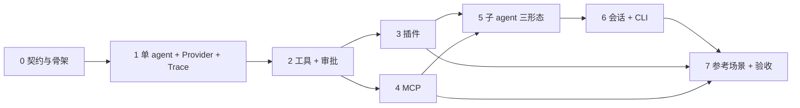

# 02 · 实现路线图

> 状态：已冻结  
> 日期：2026-11-03  
> 上游：[00-requirements.md](./00-requirements.md) · [01-architecture.md](./01-architecture.md)  
> 下游：[04-testing-and-acceptance.md](./04-testing-and-acceptance.md)

## 1. 交付策略

- **首期 = v0.1 = 一次交付全功能**：首个可发布里程碑包含全部功能需求，不做“先发半成品再补”。
- **内部拆 8 个阶段（0–7）**：阶段是执行与验收单位，不是发布单位。
- 每个阶段结束时必须通过自己的验收门禁；未通过不得进入下一阶段。
- 每个阶段有可运行的 demo，便于随时验证；但只有阶段 7 结束后才打 `v0.1.0`。
- 每个阶段开始时创建 `docs/phases/NN-<slug>.md`，结束时补齐验收证据（模板见 [TEMPLATE.md](./phases/TEMPLATE.md)）。
- 本地 commit 作为检查点；**不 push、不发布**，除非用户明确确认。

**规模标记**：S ≈ 半天到 1 天，M ≈ 2–4 天，L ≈ 5–8 天。仅用于排序，不是工期承诺。

## 2. 阶段总览

| 阶段 | 名称 | 规模 | 核心产出 | 验收门禁 |
| --- | --- | --- | --- | --- |
| 0 | 契约与骨架 | S | workspace、配置/事件/插件 schema、CLI 骨架、ADR、AGENT.md | typecheck/lint/test 绿；非法配置可诊断 |
| 1 | 单 agent + 双 Provider + 流式 + trace | M | LangGraph 主循环、Provider 注册表、流式渲染、JSONL 事件、SQLite checkpointer | 离线多轮工具循环通过；双 Provider 契约测试通过 |
| 2 | 工具内核 + 分档审批 | M | ToolRegistry、code tools、风险分级、interrupt 审批、工作区边界 | 审批矩阵/路径越界/拒绝路径测试通过 |
| 3 | 插件系统 | S/M | manifest、同进程加载、API 版本、错误隔离、示例插件 | 合法/非法/重名/崩溃四类测试通过 |
| 4 | MCP 客户端 | M | MCPAdapter、stdio/HTTP、生命周期、命名空间、风险映射 | 本地 MCP server 可列可调；崩溃/超时可控 |
| 5 | 子 agent 三形态 | L | spawn、supervisor、swarm、预算、取消传播、trace 嵌套 | 三形态各自测试通过；深度/数量/预算生效 |
| 6 | 会话 + CLI 完整体验 | M | sessions、resume、REPL 命令、trace viewer、JSON/scripted 模式 | 重启恢复；NDJSON 合法；剧本模式确定 |
| 7 | 参考场景 + 端到端验收 | M | file-agent、单一剧本、E2E runner、live smoke、README | `pnpm acceptance` 离线绿；live smoke 双 Provider 通过 |

## 3. 阶段详情

### 阶段 0 · 契约与骨架

**目标**：在任何业务/模型代码之前，把四套契约和工程骨架冻结。

**交付物**：

- pnpm workspace、两个包骨架（`@agent-shell/core`、`@agent-shell/cli`）、`bin` stub；
- TS strict + ESM + NodeNext；eslint/prettier；vitest；`packageManager`、`.nvmrc`、`.gitignore`；
- `agent-shell.config.ts` 的 zod schema（含 provider/tool/agent/preset/approval/limits/trace）；
- 事件 schema v1（事件类型、信封、payload 约定）；
- 插件 manifest schema v1 与 `PLUGIN_API_VERSION`；
- 错误类型与退出码映射；
- CLI `--help` / `--version` / `doctor` 骨架；
- ADR-0001..0008 接受；`AGENT.md` 完成；
- TS 7 工具链兼容性验证（不兼容则回退 6.0.x，并记录 ADR 修订）。

**验收**：

- `pnpm install && pnpm typecheck && pnpm lint && pnpm test` 全绿；
- `agent-shell --help` 列出全部命令；`agent-shell doctor` 在缺 key 时给出可操作错误；
- 非法配置返回 `ConfigError` + 退出码 2；
- 四套 schema 文档化，无“待定”字段。

**演示**：`agent-shell doctor` 报告缺失的 provider key、无效插件 manifest、不可达 MCP server。

**风险**：过度设计 schema；TS 7 与 tsup/eslint/vitest 的兼容性。缓解：schema 只覆盖 v1 必需字段；兼容性验证放在阶段 0 第一天。

---

### 阶段 1 · 单 agent + 双 Provider + 流式 + trace

**目标**：跑通“输入 → 模型 → 工具 → 模型 → 输出”的最小闭环，并留下完整事件流。

**交付物**：

- 自建 LangGraph 单 agent 图：`model` / `tools` / 条件边 / checkpointer；
- ProviderRegistry：`ChatOpenAI` + `ChatAnthropic`，配置、能力矩阵、超时、重试、usage；
- 流式 CLI 渲染；Ctrl+C 取消；
- 事件总线：JSONL sink + console sink；run/llm/tool 基础事件；trace 文件布局；
- SQLite checkpointer；sessionId/threadId；
- `ScriptedChatModel` 测试工具（`@agent-shell/core/testing` 子路径）；
- 一个仅用于测试的 echo 工具（不进入业务示例）。

**验收**：

- 离线剧本完成 3 轮对话，其中至少 2 次工具调用；最终输出正确；
- 双 Provider 契约测试：流式分片、tool call 解析、usage、超时、重试（本地 HTTP mock，不调用真实 API）；
- trace JSONL 合法，包含 `run.started/finished`、`llm.started/completed`、`tool.started/finished`；
- Ctrl+C 后进程退出、事件落盘、checkpoint 保留；
- 无真实 API key 时 CI 通过。

**演示**：`agent-shell run "..."`（fake provider 或本地 mock）；直接查看 `.agent-shell/traces/.../<run-id>.jsonl`（jq/编辑器）。树形 `trace show` 在阶段 6 交付。

**风险**：LangGraph 1.x 流式 API 与 interrupt 的交互；不同 provider 的 usage/流式格式差异。缓解：阶段 1 先跑通 fake provider，再接真实 provider；契约测试用本地 mock。

---

### 阶段 2 · 工具内核 + 分档审批 + 工作区边界

**目标**：让工具“可注册、可审批、可观测、不可越界”。

**交付物**：

- `ToolDefinition` / `ToolRegistry`：注册、命名规范化、冲突检测、风险必填；
- 代码工具注册（config 组合根）；
- 审批包装：LangGraph `interrupt()` + `Command({ resume })`；read 自动、write 一次、exec 两次（第二次输入 `run`）；
- allowlist、`--yolo`、非交互默认拒绝、审批超时；
- 工作区路径守卫：`..`、绝对路径越界、symlink 逃逸；
- 工具事件、结果截断、错误作为 ToolMessage 回传；
- 示例文件工具（read/write/exec）作为 file-agent 的第一批工具。

**验收**：

- 审批矩阵：read/write/exec × approve/deny/timeout/non-interactive 全覆盖；
- exec 两次确认都通过才执行；任一步拒绝则返回拒绝消息；
- 路径守卫：`../`、`/etc/passwd`、symlink 逃逸全部拒绝；
- 同一轮多个 tool call 顺序执行、审批串行、trace 顺序确定；
- 拒绝后模型能收到 ToolMessage 并给出替代方案。

**演示**：在 `examples/file-agent` 中让模型读文件、写文件、执行 `echo`，观察审批与 trace。

**风险**：interrupt/resume 与 checkpointer 的边界；双重确认的 UX 噪音。缓解：审批逻辑集中在一个 wrapper；先写矩阵测试再写 UI。

---

### 阶段 3 · 插件系统

**目标**：外部工具可以通过目录插件接入，但不破坏启动稳定性。

**交付物**：

- `plugin.json` manifest schema：`name`、`version`、`apiVersion`、`entry`、`description`；
- 同进程加载器（jiti，支持 TS/JS）；显式启用；API 版本校验；
- 插件工具命名 `plugin__<plugin>__<tool>`；风险必填；重名拒绝；
- 单个插件加载/执行失败隔离，不影响 shell 启动；
- `agent-shell plugins list`；
- 示例插件 `word-count`；
- 插件作者文档（API、manifest、风险、信任模型）。

**验收**：

- 合法插件可加载、列出、被模型调用；
- 非法 manifest、API 版本不匹配、重名、entry 不存在、插件抛错：各自可控失败；
- 插件工具仍走审批（read 自动，write/exec 按档）；
- 插件目录为空/禁用时 shell 正常启动。

**演示**：配置 `plugins/word-count`，让模型统计文件词数并审批写结果。

**风险**：TS/ESM/CJS 互操作；模块缓存导致重复加载；同进程插件可绕过审批（已在 ADR-0007 接受）。缓解：manifest 显式 entry；加载器缓存按绝对路径；文档明确信任边界。

---

### 阶段 4 · MCP 客户端

**目标**：接入外部 MCP 生态，且默认不信任。

**交付物**：

- `@langchain/mcp-adapters` v2 `MCPAdapter` 集成；
- server 配置：stdio（`command`/`args`）、HTTP/SSE（`url`）；生命周期与 `close()`；
- 懒连接、超时、错误隔离；
- 工具命名 `mcp__<server>__<tool>`；与 code/plugin 冲突检测；
- 风险映射：MCP 注解 `readOnlyHint` → read；其余默认 exec；配置可覆盖；
- `agent-shell mcp list/status`；
- 本地 echo MCP server（示例）。

**验收**：

- stdio server 可列出工具并调用；
- HTTP server 配置可校验；本地 HTTP 测试通过；
- server 崩溃/超时返回 tool error，不拖垮 shell；
- 默认风险为 exec，只读注解可降级；
- 名称冲突在启动时失败；禁用/不可达 server 不阻塞其他功能。

**演示**：MCP echo 工具 + 一个 write 工具触发审批。

**风险**：MCPAdapter v2 命名/配置细节；连接泄漏；外部 server 不稳定。缓解：adapter 内部封装；启动/关闭生命周期测试；所有调用带超时。

---

### 阶段 5 · 子 agent 三形态

**目标**：把 spawn、supervisor、swarm 三种形态做成可配置、可观测、有预算的原语。

**交付物**：

- `spawn`：`runtime__spawn_subagent` 工具；独立 messages、工具子集、独立 run/span；结果只回传最终答案；
- supervisor：包装 `createSupervisor`；`outputMode`；checkpointer；
- swarm：包装 `createSwarm` + `createHandoffTool`；`activeAgent`；checkpointer 强制；
- 预算：depth ≤ 2、每次 run ≤ 8 个子 agent、子 agent maxSteps/token/time；
- 取消传播；错误回传；trace 嵌套（`parentSpanId`）；
- 三种形态的示例 agent 与测试。

**验收**：

- spawn：子 agent 看不到父历史；工具子集被限制；子 agent 失败返回 ToolMessage；递归 spawn 被拒绝；
- supervisor：正确路由到 worker；`full_history` / `last_message` 行为符合预期；
- swarm：handoff 后 `activeAgent` 保持；跨轮恢复正确；无 checkpointer 时启动失败；
- 深度/数量/token/时间超限均有 `budget.exceeded`；
- 父 run 取消级联到子 agent。

**演示**：三个 preset：`single`、`team`（supervisor）、`swarm`；同一任务分别运行并对比 trace。

**风险**：supervisor/swarm 上游仍较年轻；swarm 仅支持 prebuilt `createReactAgent`；预算统计跨子图复杂。缓解：锁定版本 + 契约测试；adapter 隔离；必要时内联复刻。

---

### 阶段 6 · 会话 + CLI 完整体验

**目标**：从“能跑”到“像一个可用的 shell”。

**交付物**：

- SQLite `sessions` 元数据表；`sessions list/resume/new`；
- REPL 命令：`/help`、`/provider`、`/model`、`/tools`、`/plugins`、`/mcp`、`/trace`、`/new`、`/sessions`、`/quit`；
- trace viewer：`trace list/show/tail`，树形渲染 run/node/llm/tool/subagent/approval；
- 输出模式：human / `--json`（NDJSON）/ `--quiet`；`--no-color`；
- 脚本模式：`--script <file>` + 审批决策；
- `doctor` 完整检查；
- 退出码与错误消息统一。

**验收**：

- 进程重启后 `sessions resume` 恢复历史；checkpoint 可继续；
- `trace show` 正确渲染树、token、耗时、审批、子 agent 层级；
- `--json` 每行合法 JSON；脚本模式在无 TTY 下确定通过；
- 退出码符合 00/03 文档；
- `/provider` 切换后新 run 使用新 provider；同 thread 不兼容时给出 `/new` 提示。

**演示**：一次会话 → 退出 → 恢复 → `trace show` 回放。

**风险**：checkpointer 表结构与 sessions 元数据一致性；渲染长 trace 的性能。缓解：sessions 表只管元数据；trace viewer 按需加载/分页。

---

### 阶段 7 · 参考场景 + 端到端验收 + 收口

**目标**：用一条无业务参考场景证明全部能力，并完成 v0.1 收口。

**交付物**：

- `examples/file-agent` 完整场景：代码工具、`word-count` 插件、echo MCP server、三种 preset、fake model 剧本；
- `scenario.acceptance.json` + `model.script.json`；
- E2E runner（`pnpm acceptance`）：临时 workspace、启动 MCP server、加载插件、脚本化审批、断言 trace；
- live smoke 文档：双 Provider、真实 key、手动步骤与成本提示；
- 安全清单、README、docs 全量校对；
- `v0.1.0` 本地 tag（不 push）。

**验收**：

- `pnpm acceptance` 离线绿，覆盖 FR-01..FR-15；
- 单一剧本包含：双 Provider 切换、code/plugin/MCP 工具、write 审批、exec 两次审批、三种子 agent 形态、trace 回放、脱敏断言；
- `core` 无业务 import（静态检查）；
- live smoke 双 Provider 各完成一次工具调用 + 审批 + 子 agent；
- 无 P0/P1；文档链接有效；`AGENT.md` 可执行。

**演示**：`pnpm acceptance` 一条命令；随后 `agent-shell trace show <run-id>` 回放完整剧本。

**风险**：集成问题集中爆发；live smoke 依赖外部模型行为。缓解：阶段 1–6 每阶段都保留可运行 demo；acceptance 默认用 fake provider，live smoke 只做最小闭环。

## 4. 依赖图

**说明**：

- 单人推荐顺序 0→1→2→3→4→5→6→7。
- 阶段 3 与 4 在阶段 2 完成后可以交换或并行；两者都必须在阶段 5 前完成。
- 阶段 5 依赖工具内核（2）和两种外部工具源（3、4），因为验收要求三种形态都能使用完整工具集。

## 5. 需求追踪矩阵

| 需求 | 主要实现阶段 | 验收证据 |
| --- | --- | --- |
| FR-01 双 Provider | 1 | 双 Provider 契约测试 + Act 7 |
| FR-02 单 agent 循环 | 1、2 | 图测试 + Acts 1/4/5 |
| FR-03 工具注册与命名 | 2、3、4 | 工具矩阵 + Acts 1–3 |
| FR-04 三档审批 | 2 | 审批矩阵 + Acts 4/5 |
| FR-05 工作区边界 | 2 | 路径守卫测试 + 安全用例 |
| FR-06 子 agent 三形态 | 5 | 三形态测试 + Acts 6/8/9 |
| FR-07 会话持久化 | 6 | 重启恢复 + Act 10 |
| FR-08 Trace 与回放 | 1、6 | trace schema 校验 + Act 11 |
| FR-09 CLI | 0、6 | CLI E2E + Act 11 |
| FR-10 配置 | 0 | 配置校验测试 + `doctor` |
| FR-11 插件 | 3 | 插件 fixtures + Act 2 |
| FR-12 MCP | 4 | MCP 契约测试 + Act 3 |
| FR-13 参考场景 | 7 | `examples/file-agent` |
| FR-14 端到端验收 | 7 | `pnpm acceptance` |
| FR-15 运行指标 | 1、5 | usage/耗时/子 agent 断言 |
| FR-16 文档与规范 | 0–7 | 链接检查 + 各阶段 DoD |

> Acts 编号对应 [04-testing-and-acceptance.md](./04-testing-and-acceptance.md) 的单一剧本。

## 6. 首期完成定义（DoD）

- [ ] FR-01..FR-16 全部实现，无“部分完成”。
- [ ] `pnpm acceptance` 离线绿，且断言覆盖单一剧本的全部步骤。
- [ ] live smoke 双 Provider 通过，记录日期、模型、trace run ID（不记录 key）。
- [ ] 安全清单通过：审批矩阵、路径越界、秘密脱敏、插件/MCP 信任声明、非交互默认拒绝。
- [ ] `core` 无业务代码；`examples/file-agent` 是唯一业务场景。
- [ ] 四套契约冻结：config schema v1、event schema v1、plugin API v1、tool 接口 v1。
- [ ] 文档齐全且链接有效；`AGENT.md` 与实际代码一致。
- [ ] 无 P0/P1；已知限制写入 README/00 的非目标。
- [ ] `v0.1.0` 本地 tag；不 push。

## 7. 变更控制

- **范围变更**：先写 ADR，更新 00/02，再改代码；不接受口头扩张。
- **阶段跳过**：禁止。任何“先做后面再说”的要求视为范围变更。
- **依赖升级**：单独 PR；跑全量验收；破坏性变更写 ADR。
- **契约变更**：event/config/plugin API 变更必须升级版本号，并提供迁移说明。
- **延期**：只允许调整阶段顺序或并行度，不允许砍掉功能；首期范围由 ADR-0008 锁定。

## 8. 阶段文档模板

每个阶段开始时复制 [docs/phases/TEMPLATE.md](./phases/TEMPLATE.md)，命名为 `NN-<slug>.md`。阶段结束时必须包含：

- 实际改动清单；
- 验收命令与输出摘要；
- 未覆盖/已知问题；
- 与计划的偏差及原因；
- 关联 ADR / commit。
